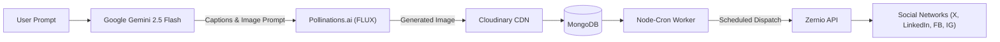

# Social Scheduler 🚀

**Social Scheduler** is a modern, full-stack AI-driven social media management and automation platform. It empowers creators, businesses, and marketing teams to go from a single prompt to high-converting post copy, photorealistic AI visuals, and automated multi-channel publishing across social platforms.

---

## 🌟 Key Features

- **🤖 AI Composer (Prompt-to-Post)**:
  - **Copywriting Engine**: Generates engaging captions, hooks, and platform-relevant hashtags powered by **Google Gemini** (`gemini-2.5-flash`).
  - **Free AI Image Generation**: Produces 1024x1024 photorealistic visuals using the cutting-edge **FLUX** model via **Pollinations.ai** — 100% free with unlimited usage, requiring zero credit cards or API keys.
  - **Tone Customization**: Choose from multiple writing tones (*Professional, Creative, Funny, Minimalist, Excited*).
- **📅 Automated Cron Dispatcher**:
  - Precision background scheduler powered by `node-cron`.
  - Automatically evaluates and dispatches pending posts and media when scheduled timestamps arrive.
- **🔗 Unified Social Media Accounts**:
  - Connect accounts across **LinkedIn, X (Twitter), Facebook, and Instagram** via the **Zernio API**.
  - One-click account synchronization and disconnection.
- **☁️ Cloud Media Management**:
  - Supports image and video uploads via `multer`.
  - Permanent asset storage and CDN delivery via **Cloudinary**.
- **📊 Real-Time Analytics Dashboard**:
  - Live statistics tracking scheduled posts, published posts, and active social channels.
  - Chronological audit log of publishing activities.
- **🔐 Secure Authentication**:
  - JWT-based authentication with bcrypt password hashing.
  - Protected client routes with persistent sessions.

---

## 🏗️ Architecture & Data Flow



---

## 🛠️ Tech Stack

### Frontend (`client/`)
- **Framework**: React 19 + TypeScript + Vite
- **Styling**: Tailwind CSS v4
- **Routing**: React Router DOM v7
- **Icons**: Lucide React & React Simple Icons
- **HTTP Client**: Axios with centralized authorization interceptors
- **Notifications**: React Hot Toast

### Backend (`server/`)
- **Runtime**: Node.js (ES Modules) with `tsx` / `nodemon`
- **Framework**: Express.js
- **Database**: MongoDB with Mongoose ODM
- **Scheduling**: Node-Cron (`* * * * *` periodic background jobs)
- **File Uploads**: Multer (Memory Storage)

### AI & Third-Party APIs
- **Google Gen AI**: `@google/genai` (Gemini 2.5 Flash)
- **Image Generation**: Pollinations.ai (FLUX / SDXL engine)
- **Social Media API**: `@zernio/node` (Multi-platform OAuth & Publishing)
- **Media CDN**: Cloudinary SDK

---

## 📁 Project Structure

```
Social Scheduler/
├── client/                     # Frontend Vite + React application
│   ├── src/
│   │   ├── api/                # Axios instance configuration
│   │   ├── assets/             # Platform metadata & icons
│   │   ├── components/         # Shared components (Sidebar, Layout, Modals)
│   │   │   └── context/        # AuthContext (JWT management)
│   │   ├── pages/              # Dashboard, Accounts, Scheduler, AIComposer, Login
│   │   ├── App.tsx             # Route declarations & toaster
│   │   └── main.tsx            # App entrypoint
│   └── package.json
│
└── server/                     # Backend Node.js + Express API
    ├── config/                 # Cloudinary, Multer, Zernio, and MongoDB configs
    ├── controllers/            # Auth, Account, Post, SocialAuth, Activity
    ├── middlewares/            # JWT authentication middleware
    ├── models/                 # User, Account, Post, Generation, ActivityLog
    ├── routes/                 # Express API routes
    ├── services/               # Background scheduler service (node-cron)
    ├── server.ts               # Server entrypoint
    └── package.json
```

---

## ⚙️ Environment Variables

Create a `.env` file inside the `server/` directory with the following keys:

```env
# MongoDB Connection
MONGODB_URI="mongodb+srv://<username>:<password>@cluster0.mongodb.net/scheduler"

# JWT Secret
JWT_SECRET="your_jwt_secret_key"

# Zernio API (Social Publishing)
ZERNIO_API_KEY="sk_your_zernio_api_key"

# Google Gemini (AI Copywriting)
GEMINI_API_KEY="your_gemini_api_key"

# Cloudinary (Media Storage)
CLOUDINARY_CLOUD_NAME="your_cloud_name"
CLOUDINARY_API_KEY="your_cloudinary_api_key"
CLOUDINARY_API_SECRET="your_cloudinary_api_secret"
```

> **Note on Image Generation**: Image generation uses Pollinations.ai FLUX, which requires **no credit card, no subscription, and no API key**.

---

## 🚀 Getting Started

### 1. Prerequisites
- **Node.js** v20+ installed
- **MongoDB Atlas** database or local MongoDB instance

### 2. Setup the Server
```bash
cd server
npm install
npm run server
```
*The server will start at `http://localhost:3000`.*

### 3. Setup the Client
In a new terminal window:
```bash
cd client
npm install
npm run dev
```
*The client will start at `http://localhost:5173`.*

---

## 🧪 Testing the Application

1. **Sign Up / Sign In**: Go to `http://localhost:5173/login` and create an account.
2. **AI Composer**: Navigate to `/ai-composer`, type a topic idea (e.g. *"Our coffee brand is launching a new organic blend"*), keep **AI Image** enabled, and click **Generate**.
3. **Schedule**: Click **Schedule Post** on any generated card or go to `/schedule` to select your channels and target date/time.
4. **Dashboard**: View your scheduled post queue and live metrics in `/dashboard`.

---

## 📄 License
This project is licensed under the [ISC License](LICENSE).
