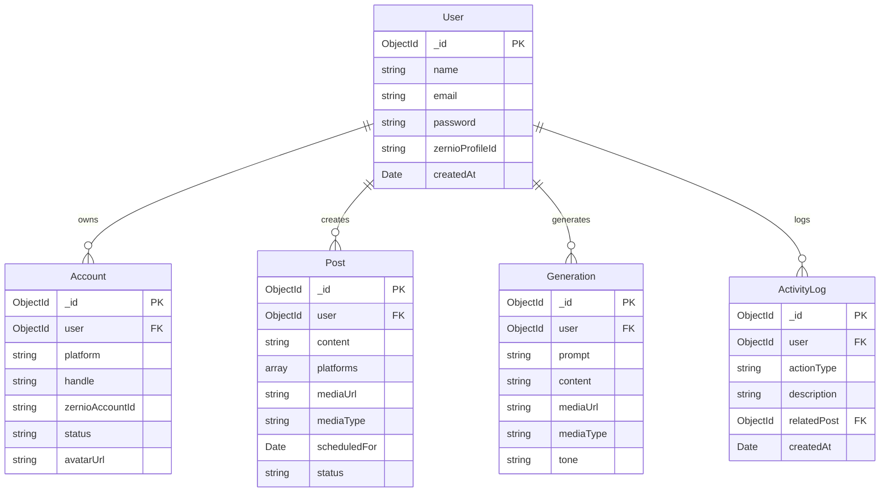

# 🚀 Social Scheduler — AI-Powered Social Media Management & Automation

[](https://nodejs.org/)
[](https://react.dev/)
[](https://www.typescriptlang.org/)
[](https://tailwindcss.com/)
[](https://expressjs.com/)
[](https://www.mongodb.com/)
[](LICENSE)

> **From a Single Prompt to Photorealistic Visuals, Persuasive Copy, and Multi-Platform Publishing on Autopilot.**

Social Scheduler is an engineering-grade, full-stack SaaS application engineered to streamline the entire social media content lifecycle. It unifies multimodal generative AI (copywriting and image synthesis), cloud asset pipelines, automated background job queues, and centralized multi-network publishing (LinkedIn, X / Twitter, Facebook, and Instagram) under one intuitive dashboard.

---

## 📑 Table of Contents

- [The Problem It Solves](#-the-problem-it-solves)
- [How It Solved the Problem](#-how-it-solved-the-problem)
- [Key Features](#-key-features)
- [System Architecture & Workflow](#-system-architecture--workflow)
- [Technical Challenges & Engineering Solutions](#-technical-challenges--engineering-solutions)
- [Tech Stack](#-tech-stack)
- [Database Schema & Models](#-database-schema--models)
- [API Endpoints Reference](#-api-endpoints-reference)
- [Environment Variables](#-environment-variables)
- [Getting Started & Installation](#-getting-started--installation)
- [Workflow Demonstration](#-workflow-demonstration)
- [Contributing & License](#-contributing--license)

---

## 🎯 The Problem It Solves

Modern content creators, solopreneurs, digital agencies, and marketing teams face severe friction when maintaining an active cross-platform social presence:

| Traditional Pain Point | Real-World Impact | How Social Scheduler Solves It |
| :--- | :--- | :--- |
| **Blank-Page Syndrome & Burnout** | Crafting high-converting hooks, hashtags, and copy across different platform tones takes hours every day. | **Google Gemini 2.5 Flash Engine**: Instantly generates contextual captions, tailored formatting, and hashtag strategies from a single sentence prompt. |
| **Expensive & Gated Visual Creation** | Midjourney or Leonardo require costly monthly plans and international credit cards (Visa/Mastercard) that block many global developers. | **Zero-Cost FLUX Pipeline**: Uses state-of-the-art **FLUX / SDXL** diffusion via Pollinations with **unlimited generations**, zero API keys, and no credit card hurdles. |
| **Tool & Tab Fragmentation** | Bouncing between ChatGPT (text), Canva/Photoshop (graphics), and Buffer/Hootsuite (scheduling) creates disjointed workflows. | **All-in-One Dashboard**: A single flow handles Prompt ➔ Copy Generation ➔ Graphic Rendering ➔ Cloud Storage ➔ Scheduling. |
| **Social API & OAuth Complexity** | Managing individual developer portals, token refreshes, and distinct API formats for Twitter, Meta, and LinkedIn is notoriously fragile. | **Unified Social Dispatcher**: Centralizes multi-platform OAuth and cross-posting through the **Zernio API** and MongoDB syncing. |
| **Manual Posting Inconsistency** | Missing optimal posting time windows due to timezone differences or manual oversight hurts algorithmic reach. | **Node-Cron Background Engine**: An automated cron queue continuously monitors pending scheduled posts and publishes them hands-free. |

---

## 💡 How It Solved the Problem

```
┌────────────────────────────────────────────────────────────────────────┐
│                          USER INPUT PROMPT                             │
│       "Announcing our new sustainable bamboo travel tumblers"          │
└───────────────────────────────────┬────────────────────────────────────┘
                                    │
                     ┌──────────────┴──────────────┐
                     ▼                             ▼
       ┌───────────────────────────┐ ┌───────────────────────────┐
       │   Google Gemini 2.5 Flash │ │   Prompt Engineering      │
       │    Caption & Hashtags     │ │   Generative Image Prompt │
       └─────────────┬─────────────┘ └─────────────┬─────────────┘
                     │                             ▼
                     │               ┌───────────────────────────┐
                     │               │   Pollinations FLUX Model │
                     │               │  1024x1024 Photoreal Art  │
                     │               └─────────────┬─────────────┘
                     │                             ▼
                     │               ┌───────────────────────────┐
                     │               │   Cloudinary CDN Pipe     │
                     │               │ Permanent Asset Hosting   │
                     │               └─────────────┬─────────────┘
                     └──────────────┬──────────────┘
                                    ▼
       ┌─────────────────────────────────────────────────────────┐
       │                   MongoDB Database                      │
       │     Post Record (Scheduled Time, Channels, Media)       │
       └────────────────────────────┬────────────────────────────┘
                                    ▼
       ┌─────────────────────────────────────────────────────────┐
       │             Node-Cron Precision Dispatcher              │
       │       Worker scans $lte: now & status: 'scheduled'      │
       └────────────────────────────┬────────────────────────────┘
                                    ▼
       ┌─────────────────────────────────────────────────────────┐
       │                       Zernio API                        │
       │       Automated Multi-Channel OAuth & Posting           │
       └─────┬──────────────┬──────────────┬──────────────┬──────┘
             ▼              ▼              ▼              ▼
         LinkedIn       X / Twitter    Instagram       Facebook
```

1. **Intelligent Copy & Graphic Orchestration**:
   - The user inputs a brief concept and chooses a tone (*Professional, Creative, Funny, Minimalist, Excited*).
   - Google Gemini generates structured JSON containing the platform-ready caption and an optimized visual prompt.
   - The visual prompt is automatically piped to the **FLUX** generative diffusion model, which outputs a 1024x1024 high-resolution image.
2. **Permanent Ingestion via Cloudinary**:
   - Instead of storing volatile temporary links, the server ingests the rendered image directly into Cloudinary’s media cloud (`folder: "ai-generations"`), securing a persistent CDN URL.
3. **Automated Scheduled Dispatch**:
   - Posts are written to MongoDB with a target timestamp and selected channels.
   - A background cron worker running every minute identifies posts whose time has elapsed, resolves connected platform IDs, and triggers atomic publishing via Zernio.

---

## ✨ Key Features

### 1. 🤖 AI Composer
- **Dual-Model Generation**: Generates text and imagery simultaneously.
- **Tone Personalization**: Switches between 5 distinctive voices to suit corporate LinkedIn or casual X/Twitter audiences.
- **Live Generation Gallery**: Historical feed of all past generations with 1-click scheduling.

### 2. 📅 Post Scheduler & Multi-Channel Queue
- **Granular Scheduling**: Pick exact date and time down to the minute.
- **Channel Selector**: Multi-select any combination of connected channels (*LinkedIn, Twitter/X, Instagram, Facebook*).
- **Manual Media Uploader**: Drag-and-drop support for custom images and MP4/MOV videos with automatic MIME-type detection.
- **Queue Views**: Clear distinction between **Upcoming Queue** and **Published History**.

### 3. 🔗 Social Accounts Hub
- **OAuth Connect Flow**: One-click authentication for major networks.
- **Automated Workspace Syncing**: Queries connected social accounts and syncs handles, avatars, and statuses into MongoDB.
- **Account Disconnect**: Safely unlinks accounts both locally and on upstream providers.

### 4. 📊 Analytics & Activity Feed
- **Live Counter Cards**: Instant statistics on Scheduled Posts, Published Posts, and Active Social Accounts.
- **Real-Time Audit Trail**: Activity log tracking post publish events with timestamps and channel receipts.

### 5. 🔐 Enterprise-Grade Security
- Password encryption using **bcrypt** (10 salt rounds).
- Stateless authorization powered by signed **JSON Web Tokens (JWT)**.
- Secure HTTP headers and authenticated API routes via custom Express middleware.

---

## 🛠️ Tech Stack

### Frontend Architecture
- **Core**: [React 19](https://react.dev/) + [TypeScript](https://www.typescriptlang.org/)
- **Build Tool**: [Vite 8](https://vitejs.dev/) with RollDown compiler optimization
- **Styling**: [Tailwind CSS v4](https://tailwindcss.com/)
- **Routing**: [React Router DOM v7](https://reactrouter.com/)
- **Icons**: [Lucide React](https://lucide.dev/) & [@icons-pack/react-simple-icons](https://simple-icons.github.io/)
- **State & HTTP**: [Axios](https://axios-http.com/) (Centralized Bearer token interceptor) + React Context API
- **User Feedback**: [React Hot Toast](https://react-hot-toast.com/)

### Backend Architecture
- **Environment**: [Node.js](https://nodejs.org/) (ES Modules) executed with [TSX](https://github.com/privatenumber/tsx)
- **Framework**: [Express.js v5](https://expressjs.com/)
- **Database**: [MongoDB Atlas](https://www.mongodb.com/atlas) with [Mongoose v9](https://mongoosejs.com/) ODM
- **Task Scheduling**: [Node-Cron](https://github.com/node-cron/node-cron)
- **File Ingestion**: [Multer](https://github.com/expressjs/multer) (Memory Storage Engine)

### External APIs & Cloud Infrastructure
- **Copywriting LLM**: **Google Gemini 2.5 Flash** (`@google/genai`)
- **Diffusion Model**: **Pollinations.ai** (FLUX.1 / SDXL engines)
- **Asset Storage & CDN**: **Cloudinary** SDK v2
- **Social Media API**: **Zernio API** (`@zernio/node`)

---

## 🔬 Technical Challenges & Engineering Solutions

### 1. Removing the Payment Wall for Generative Visuals
* **Challenge**: The original architecture used Leonardo.ai, which requires paid credits tied to international credit cards (Visa/Mastercard), blocking users without access to those cards.
* **Solution**: Migrated to **Pollinations.ai** running the open-source **FLUX** model. It produces photorealistic 1024x1024 images with zero payment gateways, zero API tokens, and unlimited requests.
* **Resilience**: Implemented a secondary fallback to standard SDXL if the FLUX cluster experiences heavy traffic, ensuring the user's generation request never fails.

### 2. Server-to-Server Cloud Media Pipeline
* **Challenge**: Downloading generated images to the local server disk wastes memory and causes storage leaks on serverless or containerized hosts.
* **Solution**: Utilized Cloudinary's direct remote ingestion endpoint (`cloudinary.uploader.upload(remoteUrl)`). Cloudinary retrieves the generated image directly from the diffusion server and stores it in cloud CDN storage without touching local disk.

### 3. Precision Job Queue for Timed Publishing
* **Challenge**: Publishing at exact scheduled times across multiple channels while avoiding race conditions and duplicate dispatches.
* **Solution**: Engineered a recurring 60-second cron runner in `schedulerService.ts`. It executes atomic status transitions (`status: 'scheduled'` ➔ `status: 'published'`) with MongoDB query filtering (`scheduledFor: { $lte: new Date() }`), verifying connected channel profiles before dispatch.

### 4. Seamless Multipart/Form-Data Handling
* **Challenge**: The scheduler needed to support both AI-generated image URLs (JSON payloads) and locally uploaded image/video files (Multipart payloads).
* **Solution**: Configured `multer` memory storage alongside Cloudinary `upload_stream`. If a raw binary file is attached, it streams directly to Cloudinary and assigns `resource_type: "video"` or `"image"` automatically; if a URL is provided, it passes the pre-existing CDN link directly.

---

## 🗄️ Database Schema & Models



---

## 📡 API Endpoints Reference

### 🔐 Authentication (`/api/auth`)
| Method | Endpoint | Description | Auth Required |
| :--- | :--- | :--- | :--- |
| `POST` | `/api/auth/register` | Register new user account with hashed password | No |
| `POST` | `/api/auth/login` | Authenticate credentials and receive JWT | No |

### ✍️ Posts & AI Generation (`/api/posts`)
| Method | Endpoint | Description | Auth Required |
| :--- | :--- | :--- | :--- |
| `POST` | `/api/posts/generate` | Generates text (Gemini) + image (FLUX) and persists to DB | Yes (Bearer) |
| `GET` | `/api/posts/generations` | Retrieves user's past AI generations | Yes (Bearer) |
| `GET` | `/api/posts` | Fetches all scheduled and published posts | Yes (Bearer) |
| `POST` | `/api/posts` | Creates and schedules a post (supports multipart files) | Yes (Bearer) |

### 🌐 Connected Accounts & OAuth (`/api/accounts` & `/api/oauth`)
| Method | Endpoint | Description | Auth Required |
| :--- | :--- | :--- | :--- |
| `GET` | `/api/accounts` | Lists all connected social accounts | Yes (Bearer) |
| `DELETE`| `/api/accounts/:id` | Unlinks an account from MongoDB and Zernio | Yes (Bearer) |
| `GET` | `/api/oauth/:platform/url`| Generates platform OAuth redirect URL | Yes (Bearer) |
| `GET` | `/api/oauth/sync` | Syncs connected platforms from Zernio to MongoDB | Yes (Bearer) |

### 📈 Activity (`/api/activity`)
| Method | Endpoint | Description | Auth Required |
| :--- | :--- | :--- | :--- |
| `GET` | `/api/activity` | Fetches the recent 10 publishing and account events | Yes (Bearer) |

---

## ⚙️ Environment Variables

Create a `.env` file in the `server/` directory:

```env
# -------------------------------------------------------------
# DATABASE & SECURITY
# -------------------------------------------------------------
MONGODB_URI="mongodb+srv://<username>:<password>@cluster0.mongodb.net/scheduler"
JWT_SECRET="your_strong_jwt_secret_phrase"
PORT=3000

# -------------------------------------------------------------
# THIRD-PARTY SERVICES
# -------------------------------------------------------------
# Zernio API (Multi-Platform Social OAuth & Dispatch)
ZERNIO_API_KEY="sk_your_zernio_api_key"

# Google Gemini API (AI Copywriting)
GEMINI_API_KEY="your_gemini_api_key_from_google_ai_studio"

# Cloudinary (Cloud Asset Storage)
CLOUDINARY_CLOUD_NAME="your_cloudinary_cloud_name"
CLOUDINARY_API_KEY="your_cloudinary_api_key"
CLOUDINARY_API_SECRET="your_cloudinary_api_secret"

# -------------------------------------------------------------
# NOTE: Image Generation uses Pollinations.ai FLUX (100% Free)
# No API key or credit card is required for image generation.
# -------------------------------------------------------------
```

---

## 🚀 Getting Started & Installation

### Prerequisites
- [Node.js](https://nodejs.org/) v20.0.0 or higher
- [MongoDB Atlas](https://www.mongodb.com/atlas) cluster (or local MongoDB)
- Free accounts on [Cloudinary](https://cloudinary.com/), [Google AI Studio](https://aistudio.google.com/), and [Zernio](https://zernio.com/)

### 1. Clone the Repository
```bash
git clone https://github.com/TusharC19/Social-Scheduler.git
cd "Social Scheduler"
```

### 2. Backend Setup
```bash
cd server
npm install
npm run server
```
*The server will start on `http://localhost:3000` with active MongoDB connection and background cron workers.*

### 3. Frontend Setup
In a second terminal window:
```bash
cd client
npm install
npm run dev
```
*The client will launch on `http://localhost:5173`.*

---

## 🖥️ Workflow Demonstration

1. **Sign Up**: Navigate to `http://localhost:5173/login`, click **Create one free**, and register.
2. **AI Composer**:
   - Go to **AI Composer** in the sidebar.
   - Enter your post topic: *"We are launching our AI-powered productivity workspace tomorrow!"*
   - Pick a tone: **Excited** or **Professional**.
   - Keep **AI Image** toggled on and click **Generate**.
   - Gemini crafts the caption and hashtags, while FLUX generates the 1024x1024 image.
3. **1-Click Scheduling**:
   - Click **Schedule Post** on the generated card.
   - Select your target social channels, set the date and time, and click **Schedule Post**.
4. **Autonomous Dispatch**:
   - The cron worker detects the post at the specified time, resolves your Zernio profiles, and publishes it across all selected social platforms automatically.
5. **Dashboard Audit**:
   - Check the **Dashboard** to monitor active metrics and review the activity log.

---

## 🤝 Contributing

Contributions, issues, and feature requests are welcome!
1. Fork the Project.
2. Create your Feature Branch (`git checkout -b feature/AmazingFeature`).
3. Commit your Changes (`git commit -m 'Add some AmazingFeature'`).
4. Push to the Branch (`git push origin feature/AmazingFeature`).
5. Open a Pull Request.

---

## 📄 License

Distributed under the **ISC License**. See `LICENSE` for more information.
